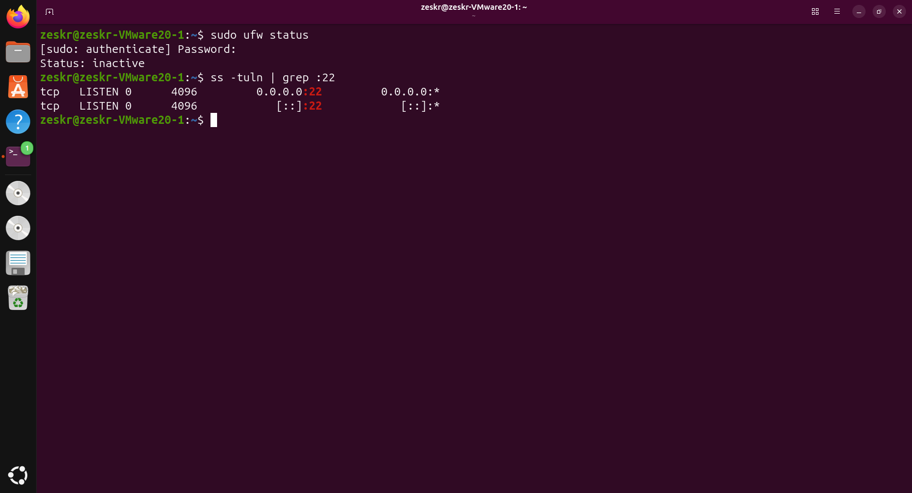
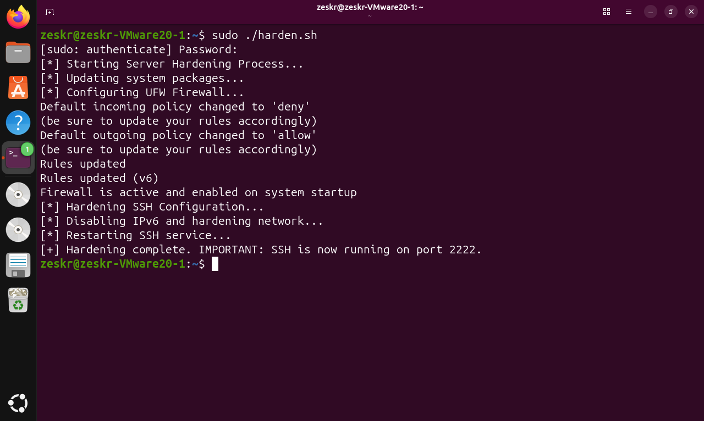
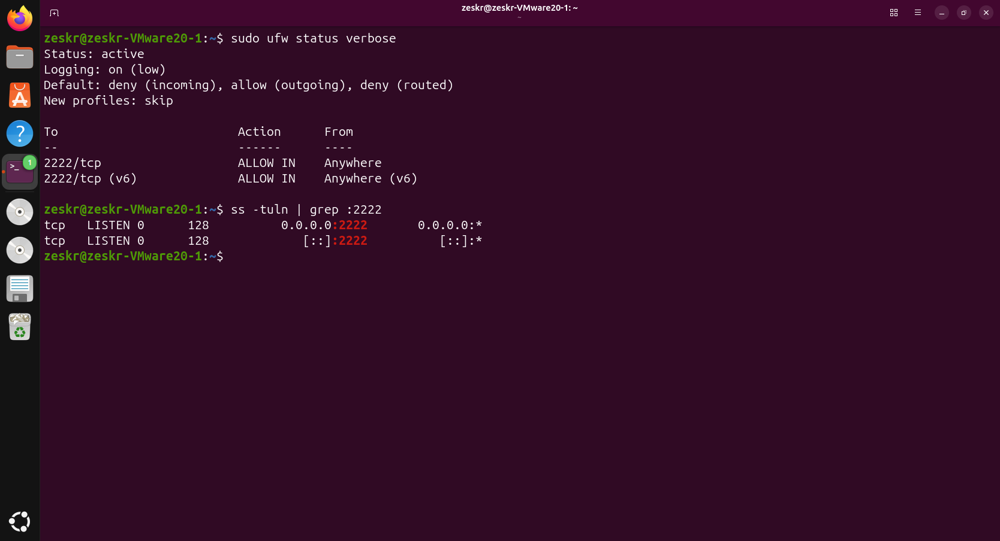

# 🛡️ Automated Linux Hardening Script

## Overview
A Bash automation script designed to enforce immediate infrastructure baseline security on raw Debian/Ubuntu deployments. This script programmatically hardens the kernel against network-level attacks, configures the local firewall, and restricts remote access protocols to mitigate automated exploitation and brute-force campaigns.

## Technical Skills Applied
* **Linux Systems Administration:** Proficient in securing SSH daemon configurations (`sshd_config`) and managing Linux services via `systemd`.
* **Security Automation:** Utilizing Bash scripting and `sed` stream editing for automated, reproducible file manipulation.
* **Network Defense:** Modifying kernel parameters via `sysctl` for low-level network defense (e.g., SYN flood protection, disabling IPv6) and configuring Uncomplicated Firewall (UFW) default-deny policies.
* **OS Troubleshooting:** Diagnosing and bypassing default OS routing behaviors (e.g., modern Ubuntu `ssh.socket` activation) to enforce custom service configurations.

## Installation & Usage

*Note: This script alters live system configurations, firewall rules, and network routing. Run only on disposable test environments or virtual machines.*

```bash
# Clone the repository
git clone [https://github.com/Zeskr/Linux-Server-Hardening.git](https://github.com/Zeskr/Linux-Server-Hardening.git)
cd Linux-Server-Hardening

# Make the script executable and run as root
chmod +x harden.sh
sudo ./harden.sh
```

---

## Technical Execution & Proof of Concept

### Phase 1: Pre-Deployment Vulnerability
A raw Ubuntu server defaults to an inactive firewall and runs the SSH daemon on the heavily targeted default port 22, leaving it highly susceptible to automated scanning and brute-force attacks.



### Phase 2: Automated Deployment
Executing the script automatically updates system packages, enables UFW with a default-deny incoming policy, modifies the SSH configuration file to migrate off port 22, and injects protective `sysctl` kernel parameters.



### Phase 3: The Secured State
Post-execution verification confirms the server is now actively dropping unapproved incoming traffic and the SSH service has successfully migrated to the custom port (2222). 



---

### 💡 Engineering Note: Defeating systemd Socket Activation
During the development of this automation, modern Ubuntu's default `ssh.socket` activation continuously overrode the custom `sshd_config` file, silently forcing the system to listen on port 22 despite the service restart. I successfully diagnosed this `systemd` behavior, manually disabled the overriding socket (`systemctl disable --now ssh.socket`), and re-enabled the standard `ssh.service` to successfully enforce the custom infrastructure configuration.
